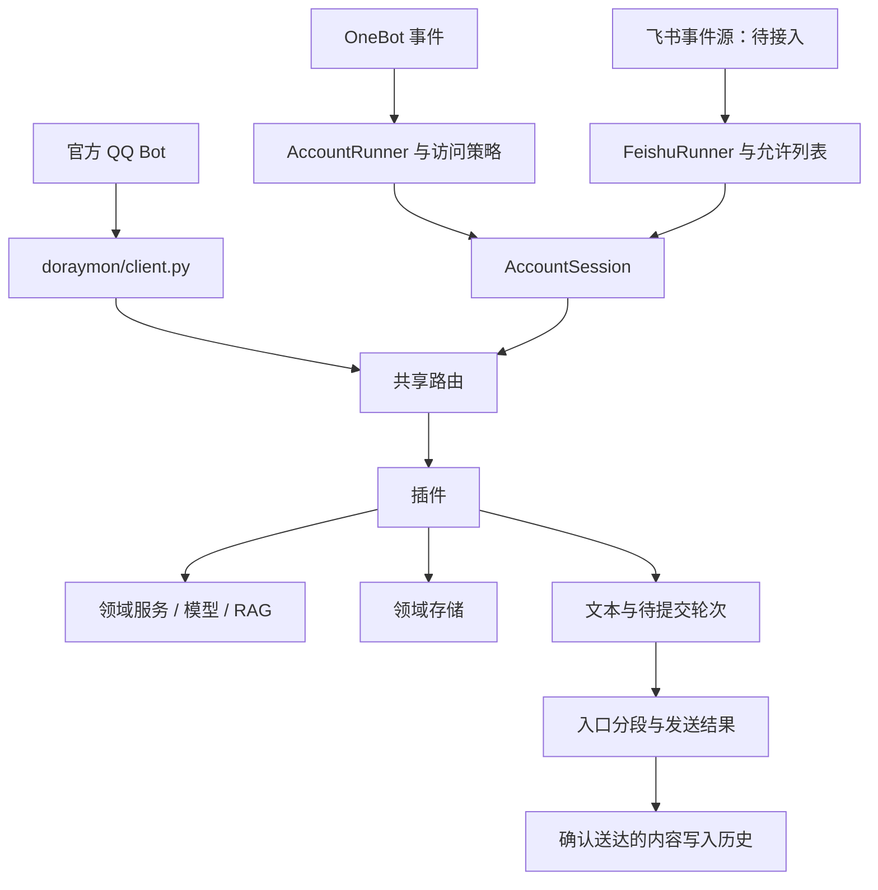

# 架构说明

DoraYmon 是插件化 Python 助手，使用 DeepSeek、SQLite 和本地 FTS5/BM25 检索。官方 QQ Bot、QQ 账号和飞书有各自入口；后两者复用消息会话层。能力与运行状态分别记录，当前文档入口见 [文档导航](README.md)。

## 入口与分层

| 层 | 实现 | 职责 |
|---|---|---|
| 官方 QQ 启动与客户端 | `main.py`、`doraymon/client.py` | botpy 事件、回复窗口、分段发送、QQ API 结果 |
| QQ 账号入口 | `scripts/run_account.py`、`doraymon/account_entry.py` | 配置、普通聊天/封闭名单、装配 OneBot 传输、群参与和会话 |
| 飞书入口 | `scripts/run_feishu.py`、`doraymon/feishu_entry.py` | 配置、允许列表、装配飞书适配器和传输；SDK 事件源尚待接入 |
| 消息契约与适配 | `services/message_contract.py`、`onebot_adapter.py`、`feishu_adapter.py` | 平台事件转换、去重、引用解析接缝、出站动作与业务拒绝判定 |
| 会话 | `services/account_session.py`、`session_scheduler.py` | 按会话排队、寻址、路由、节流、分段、发送结果与关闭；服务于 QQ 账号和飞书 |
| QQ 群对话 | `services/group_dialogue.py` | 内存公共窗口、选择性参与、连续对话和局部结束；由 QQ 入口显式注入 |
| 路由与插件 | `doraymon/router.py`、`plugins/` | 显式命令、自然意图、普通聊天回退；插件返回文本 |
| 对话与领域服务 | `services/` | 上下文、提示词、模型、RAG、用餐状态、地点查询、来源和预算 |
| 持久化 | `storage/` | SQLite 表、完整问答轮次、摘要、知识索引与领域记录 |

`services/` 同时包含传输边界和领域服务；修改时按上表识别职责。增加第二个协议已验证适配器接缝的用途，现阶段无需再包一层通用框架。

## 消息流



私聊普通文本可回退到聊天。群聊先判断是否应回复，再进入路由；QQ 账号支持 @、引用、叫名字、连续追问和普通内容选择性参与，飞书仍沿用 @ 与引用。实际 @ 与接话判断分别放在 `is_at_message` 和 `addressed_to_bot`，避免把选择性参与伪造成平台 @。显式命令、餐饮意图和用餐追问依次处理，静默规则与访问策略分别保留在相应边界。

QQ 的 `GroupDialogue` 只观察访问策略通过的群消息；保存发言人、时间、提及与引用正文的有界公共窗口。该窗口通过 `ConversationContext` 作为不可信用户资料进入聊天请求，不写入成员个人历史，不参与个人口味/预算合并。群普通参与与直接请求使用各自的计数和发送锁；成功送达后计数和激活个人连续对话。局部停聊取消该成员的生成与排队输入并使旧用餐状态失效；清空同时移除其公共分支。

QQ 账号和飞书共用 `SessionScheduler`：同一 `SessionKey` 按输入顺序处理，不同会话最多 4 个并行；普通任务总上限 64，单会话上限 8，满载拒绝并计数。清空命令有有界的优先入口，取消该会话旧生成和排队输入，新输入排在清空之后。两种传输均限制在途事件任务，关闭时取消并等待任务退出；飞书队列另有限额，SDK 线程在调度回调前预占容量。

地点查询、模型与飞书发送分别使用最多 4 个工作线程的受控执行器。取消等待者不会提前释放仍在运行的请求容量；无法中止的同步 HTTP 请求按自身超时结束，不再提交已失效的会话状态。食物插件在事件循环解析和提交用餐状态，只把目录读取、地点与网络查询放入线程。

## 对话与知识

普通聊天经 `ConversationService`：`context_builder` 选择完整轮次、短期摘要和可选资料，`prompt_builder` 拼请求，模型生成后由 `reply_postprocess` 处理文本和实际引用。`ConversationResponse.is_error` 区分模型失败；关闭历史和 RAG 时仍经过同一编排，使用 system + user。

`session_history` 为 chat、food、knowledge 共用历史策略。插件返回兼容文本的 `PendingReply`，由消息出口通过 `commit_delivered_reply` 一次性提交平台确认送达的连续片段；拒绝、未知结果和未发送的尾段不进入历史。模型失败跳过保存，无资料拒答在送达后可以保存。官方 QQ 同样遵守投递后提交；CLI 和离线回放显式模拟成功展示。生成与投递阶段均核对 revision，清空后的旧结果不回写。

`summary_service` 在确认投递并保存历史后后台生成有限摘要，失败时退回本地节选。QQ 账号/飞书会话跟踪摘要任务并在关闭时取消等待者。`chat_summary_store.save_summary_if_current` 在 `BEGIN IMMEDIATE` 事务内核对最新消息 ID 并保存，防止过时摘要覆盖更新的数据。

```text
管理员整理的 Markdown/TXT
  → knowledge_store：发现、分块、作用域、FTS5/BM25
  → RagService：Top-K、预算、来源与严格拒答
  → DeepSeek → 答案及实际引用
```

严格知识问答在资料不足时拒答；普通聊天的可选知识检索失败可降级继续对话。公共、群和私人资料按授权作用域过滤。Embedding、向量检索和长期个人记忆尚未实现。

## 状态生命周期

| 状态 | 生命周期与所有者 |
|---|---|
| 原始平台 ID、消息和引用 | 事件/适配器；原始 ID 用于平台寻址与允许列表 |
| 历史、用餐会话键 | `identity` 与 `session_history`，按平台、机器人账号及用户/群构造命名空间 |
| SQLite 历史与摘要 | 存储层；入口数据目录分别隔离，保留过期/清空契约 |
| 去重、revision、节流、静默、用量统计 | 当前为进程内状态，重启语义应在功能说明中明确 |
| 群公共窗口与连续对话 | QQ 入口持有 `GroupDialogue`；至多 128 群、每群 24 条/约 6000 字符/5 分钟；个人分支 120 秒，每群最多 128 个；关闭会话时清理 |
| 地点缓存与每轮预算 | `NearbyLookup.new_turn()` 隔离预算、notes 和起点；共享缓存加锁，地点/页面各上限 128、地理编码 32，查询配置模板上限 16；访问时清理过期项及页面来源 |
| 投递结果 | 发送层的 SendResult；保留成功、失败和未知结果，不盲目重发 |

`data/`、`logs/`、私有知识与本机协作记录不是公开源码。入口默认分别使用运行数据目录；跨入口共享数据、旧 ID 迁移和长期记忆策略需要单独设计与验收。

## 扩展方式

新增功能先明确用户行为，再决定插件、服务或存储的所属层。优先使用现有契约和接缝；阻塞 I/O、状态提交、投递确认与渲染应各有明确边界。验证分别记录离线行为、真实平台往返、真实模型质量和持续运行。
